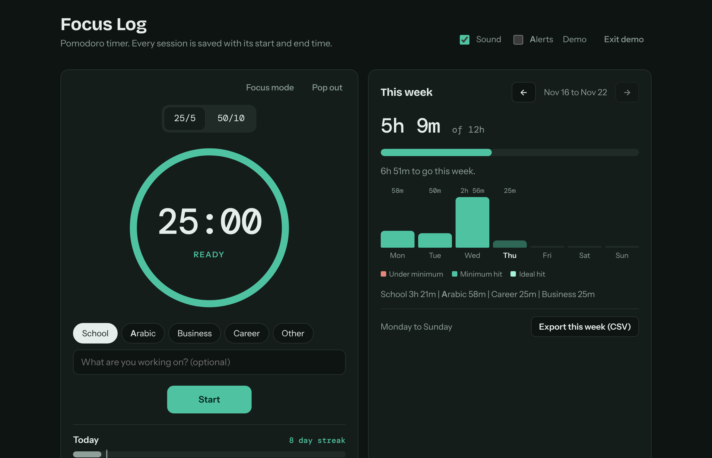
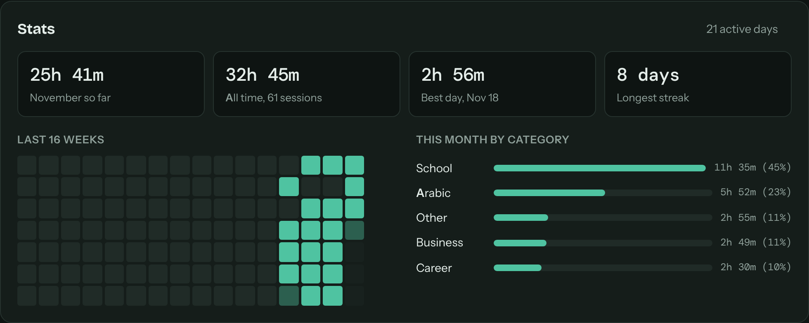
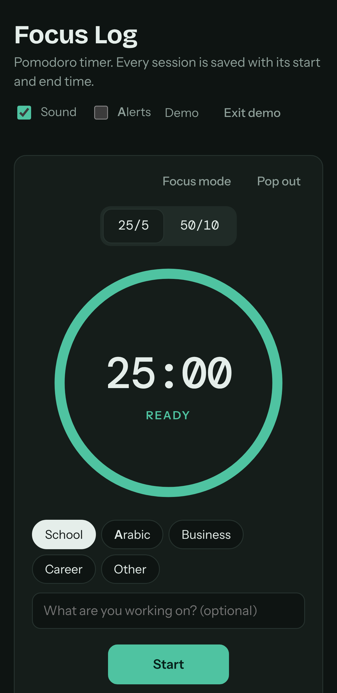
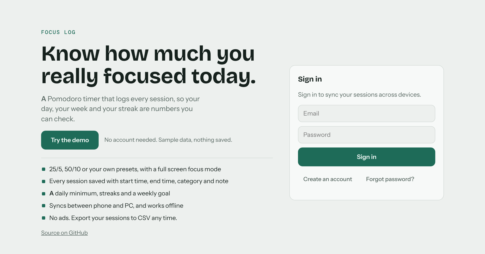

# Focus Log

A Pomodoro and deep-work tracker that saves every session, so your day, your week and your streak are numbers you can check. It installs like an app, syncs between phone and PC, and keeps working offline.

**[Try the live demo](https://sushant-ships.github.io/focus-log/?demo=1)** (no account needed, sample data, nothing saved)

## What it does

- **Timer:** 25/5 and 50/10 presets plus your own, a full screen focus mode, and a small pop-out window that floats over other apps.
- **Automatic logging:** every finished or stopped session is saved with its start time, end time, length, category and note. You can also add or edit sessions by hand.
- **Goals and streaks:** a daily minimum, a daily ideal, a weekly goal, and a streak for days that hit the minimum.
- **Stats:** month and all-time totals, best day, longest streak, a 16-week consistency grid, and time by category.
- **Alerts:** an optional notification when a session or break ends while you are in another tab.
- **Your data:** CSV export for a week or for everything. No ads and no trackers.

| Stats | Phone | Sign-in page |
|---|---|---|
|  |  |  |

Keyboard shortcuts: `Space` starts or pauses, `F` toggles focus mode, `Esc` leaves it.

## Tech stack

- **Frontend:** plain HTML, CSS and JavaScript. No framework and no build step, so the whole app is a handful of files.
- **Backend:** Supabase (Postgres, email and password auth, row level security).
- **Hosting:** GitHub Pages.
- **Installable app:** a web app manifest and a service worker make it a PWA on Android, iPhone, Windows and Mac.

## How sync works

The app is offline-first. The copy on your device is the one you see, and the server is updated behind it.

1. A saved session is added to the list on screen and to a local cache right away.
2. The app then writes it to Supabase. Each session gets its ID on the device, so sending the same session twice cannot create a duplicate.
3. If the write fails, the session goes into a pending queue in local storage. A banner shows how many are waiting, and the queue is sent again when the browser comes back online.
4. On load, the app shows the cached copy first, then fetches from the server and merges in anything still pending.
5. The service worker serves the app shell network-first with a cache fallback, so updates arrive when you are online and the app still opens when you are not. Calls to Supabase are never cached.

The timer survives a closed tab as well. Its state is stored locally, so a session that finished while the app was closed is saved the next time you open it, and a timer left paused for 15 minutes is stopped and saved.

## How security works

- **Row level security** is on for both tables. Every policy checks `auth.uid() = user_id`, so a signed-in user can only read and write their own rows.
- **The anon key in `config.js` is public by design.** It only identifies the project. Access is decided by the policies in [`schema.sql`](schema.sql), not by keeping the key secret.
- **Signed-out visitors have no table access.** All grants are revoked from the `anon` role.
- **Demo mode never touches the database.** It generates sample sessions in memory and writes nothing to the server or to browser storage.
- **User text is written to the page with `textContent`,** not as HTML, and CSV export escapes cells that could be read as spreadsheet formulas.

## Run your own copy

1. Create a free Supabase project. In the SQL Editor, run everything in `schema.sql`.
2. In Project Settings > API, copy the project URL and the anon public key into `config.js`.
3. In Authentication > URL Configuration, set the Site URL and a Redirect URL to the address where you will host the app.
4. Host the folder on any static host. For GitHub Pages: Settings > Pages > Deploy from a branch > `main` > `/ (root)`.
5. Open the site, create an account, and install it from the browser menu.

To try it locally, serve the folder with any static server, for example `python3 -m http.server`, and open `http://localhost:8000/?demo=1`.

## Project layout

| File | Purpose |
|---|---|
| `index.html` | Markup and styles |
| `app.js` | Timer, logging, sync, stats and demo mode |
| `sw.js` | Offline app shell and notification clicks |
| `schema.sql` | Tables, row level security policies and grants |
| `config.js` | Supabase project URL and anon key |
| `manifest.webmanifest` | Install metadata and icons |

## Roadmap

- Open sign-ups with a short first-run setup
- Qur'an reading goals alongside focus goals, for Muslim students
- Android app on Google Play

## License

[MIT](LICENSE)
